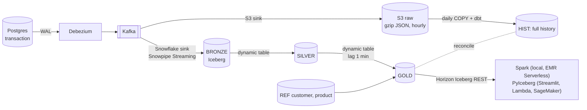

# cdc-lab

A hands-on lab for a modern CDC / streaming lakehouse:
**Postgres → Debezium → Kafka → (S3 raw archive + Snowflake Iceberg bronze) → dynamic tables (silver, gold) + a daily batch path + reconciliation**, read through Snowflake's Horizon Catalog by Spark, a Streamlit dashboard, Lambda, EMR Serverless and SageMaker.



| Runs where | What |
|---|---|
| Your Mac (Docker) | Postgres, Kafka (KRaft), Kafka Connect (Debezium + Snowflake sink + S3 sink), Spark (on demand) |
| Your Mac (Python) | traffic generator, dbt, Terraform, Streamlit dashboard |
| AWS ap-southeast-2 | S3 raw bucket, IAM; readers of gold: Lambda, EMR Serverless, SageMaker notebook (Terraform) |
| Snowflake | CDC_LAB database: Iceberg tables on Snowflake storage, dynamic tables, batch tables, reconciliation (Terraform + dbt) |

## Repository layout
Top-level folders follow the pipeline, left to right.
```
source/                   generator.py (OLTP traffic: 80% insert / 20% status update), sql/ (table DDL)
docker-compose.yml        Postgres, Kafka, Kafka Connect (local)
connect/                  connector configs (JSON); plugins/ (sink jars, gitignored)
terraform/core/           S3 raw bucket, IAM + Snowflake: warehouse, database, roles, users, bronze, batch stage
terraform/readers/        optional AWS readers of gold (own state): Lambda, EMR Serverless, SageMaker
terraform/bootstrap/      one-time SQL: TERRAFORM_SVC
dbt/                      seeds (dims), macros (the shared logic), models realtime/ batch/ recon/
readers/                  read gold through Horizon: horizon.py (shared), Streamlit dashboard, Lambda handler,
                          Spark job (local Docker + EMR), SageMaker notebook
scripts/                  every command of the lab; _env.sh = shared settings from .env
Makefile                  the entry points: `make` lists them
```

## Settings
One place: `.env` (copy `.env.example`). Every script loads it through `scripts/_env.sh`; `scripts/tf.sh` passes it to Terraform, so there is no `terraform.tfvars`.

## Daily use
```bash
export AWS_PROFILE=dpivoted            # AWS SSO (aws sso login --profile dpivoted)
make on                                # Docker up, connectors resume, dynamic tables + purge task resume
make traffic                           # traffic generator (second terminal)
make check                             # local health: Postgres → Debezium → Kafka
make batch                             # batch path + reconciliation (all S3 files not loaded yet)
make spark                             # Spark (Docker) reads gold through Horizon
make dashboard                         # Streamlit: today's sales (http://localhost:8501)
make off                               # stop spending: generator, dynamic tables, task, Docker (data kept)
```
AWS readers (optional; the NAT gateway and the notebook bill per hour while on):
```bash
make lambda-zip                        # once: build/lambda.zip
scripts/tf.sh readers init             # once
scripts/aws-readers.sh off             # first apply: everything without hourly cost
scripts/aws-readers.sh key             # once: READER_SVC's private key → Secrets Manager
make readers-on readers-test readers-off
```
Terraform: `scripts/tf.sh core plan` / `scripts/tf.sh readers plan` (any Terraform command).

## Security (public repo)
No secrets, keys, state or account identifiers in git. They live in gitignored `.env`, `terraform/core/backend.hcl`, and `~/.snowflake/keys/`. Snowflake access is key-pair only (`TYPE = SERVICE` users). On AWS, the reader key is in Secrets Manager (not in Terraform state).
