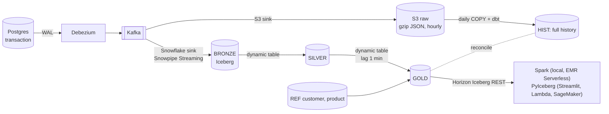

# cdc-lab

A hands-on lab for a modern CDC / streaming lakehouse:
**Postgres → Debezium → Kafka → (S3 raw archive + Snowflake Iceberg bronze) → dynamic tables (silver, gold) + a daily batch path + reconciliation**, read through Snowflake's Horizon Catalog by Spark, a Streamlit dashboard, Lambda, EMR Serverless and SageMaker.



| Runs where | What |
|---|---|
| Your Mac (Docker) | Postgres, Kafka (KRaft), Kafka Connect (Debezium + Snowflake sink + S3 sink), Spark (on demand) |
| Your Mac (Python) | traffic generator, dbt, Terraform, Streamlit dashboard |
| AWS ap-southeast-2 | S3 raw bucket, IAM; readers of gold: Lambda, EMR Serverless, SageMaker notebook (Terraform) |
| Snowflake | CDC_LAB database: Iceberg tables on Snowflake storage, dynamic tables, batch tables, reconciliation (Terraform + dbt) |

## Docs
| Read | For |
|---|---|
| [doc/guide.md](doc/guide.md) | **Start here:** how the system works and a step-by-step walk through it, following one event end to end |
| [doc/plan/overview.md](doc/plan/overview.md) | Design: components, decisions, data layers, phases |
| [doc/plan/manual/](doc/plan/manual/README.md) | How it was built, one phase per doc, every command explained |

## Repository layout
```
docker-compose.yml        Postgres, Kafka, Kafka Connect (local)
src/generator.py          OLTP traffic: 80% insert / 20% status update
sql/postgres/             source table DDL
connect/                  connector configs (JSON) + plugins/download.sh (sink jars, gitignored)
terraform/                one stack: AWS (S3, IAM) + Snowflake (warehouse, DB, roles, users, bronze, stage)
bootstrap/snowflake/      one-time SQL: TERRAFORM_SVC
dbt/                      seeds (dims), macros (the shared logic), models realtime/ batch/ recon/
spark/                    read Iceberg tables through Horizon (Spark in Docker, EMR Serverless)
readers/                  PyIceberg through Horizon: shared module, Streamlit dashboard, Lambda handler, SageMaker notebook
scripts/                  connect-apply, check-local, dbt, run-batch, lab-on, lab-off, dashboard, build-lambda, aws-readers
doc/                      guide, plan, phase docs
```

## Daily use
```bash
export AWS_PROFILE=dpivoted            # AWS SSO (aws sso login --profile dpivoted)
scripts/lab-on.sh                      # Docker up, connectors resume, dynamic tables + purge task resume
uv run python src/generator.py         # traffic (second terminal)
scripts/check-local.sh                 # local health: Postgres → Debezium → Kafka
scripts/run-batch.sh                   # batch path + reconciliation (all S3 files not loaded yet)
spark/read.sh GOLD.TRANSACTION_ENRICHED
scripts/dashboard.sh                   # Streamlit: today's sales (http://localhost:8501)
scripts/aws-readers.sh on              # AWS readers: then lambda | emr | sagemaker, and off when done (hourly cost while on)
scripts/lab-off.sh                     # stop spending: generator, dynamic tables, task, Docker (data kept)
```

Terraform needs `build/lambda.zip` to plan: run `scripts/build-lambda.sh` once after cloning.

## Security (public repo)
No secrets, keys, state or account identifiers in git. They live in gitignored `.env`, `terraform/terraform.tfvars`, `terraform/backend.hcl`, and `~/.snowflake/keys/`. Snowflake access is key-pair only (`TYPE = SERVICE` users). On AWS, the reader key is in Secrets Manager (not in Terraform state).
